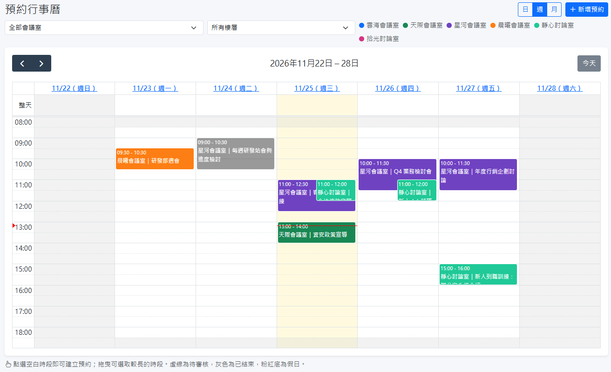
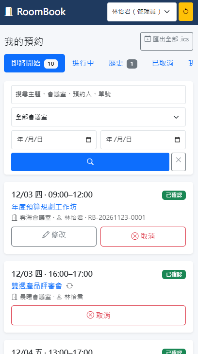
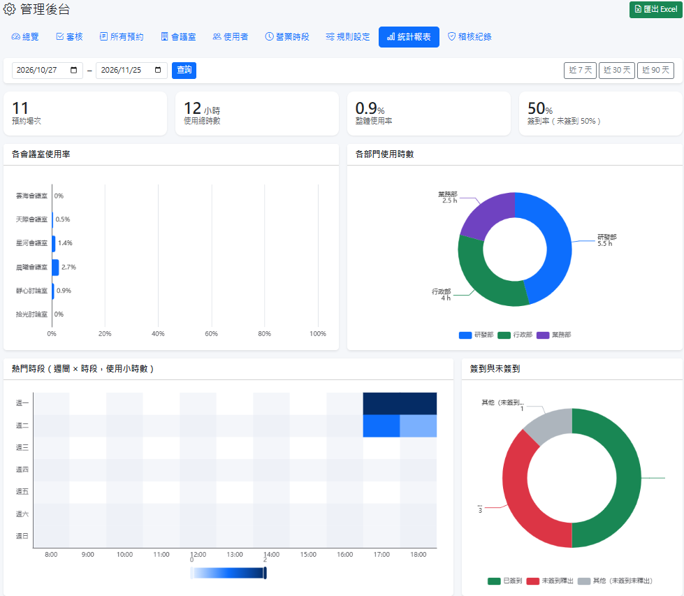
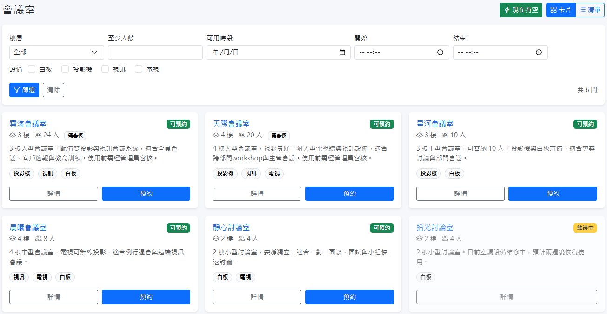
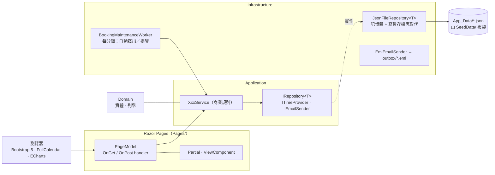

# RoomBook 會議室預約系統

公司內部可實際使用的會議室預約系統，以 **ASP.NET Core Razor Pages（.NET 10）** 實作。
資料存在 JSON 檔（無資料庫、無 EF Core），商業邏輯與儲存分離，日後可換成資料庫而不必改商業邏輯。
桌機與手機（RWD，底部導覽）都好用；前端函式庫全部放在 `wwwroot/lib`，**可離線執行**，不使用任何付費服務或 API Key。

| | |
|---|---|
|  |  |
|  |  |

> 截圖占位：請把畫面存成 `docs/screenshots/*.png`（上列檔名）。

## 啟動方式

```powershell
dotnet run --project RoomBook
```

開啟 <http://localhost:5046>。首次啟動會自動從 `SeedData/` 複製範例資料到 `App_Data/`。

## Demo 帳號

密碼皆為 `RoomBook#2026`（Development 環境登入頁也會顯示，右上角有「快速切換使用者」）。

| 帳號 | 姓名 | 說明 |
|---|---|---|
| `admin` | 林怡君 | 管理員（行政部） |
| `zhihao` `yating` | 陳志豪、王雅婷 | 業務部員工 |
| `jiaming` `hsinyi` | 張家銘、李欣怡 | 研發部員工 |
| `bohan` | 黃柏翰 | 行政部員工 |
| `guanyu` | 劉冠宇 | 違規 3 點，目前**暫停預約** |
| `shufen` | 吳淑芬 | **已停用**帳號（登入會被拒絕） |

管理頁與右上角工具列（Development）都有「重置為範例資料」。範例資料的日期**相對於產生當天**，Development 重置時會重新產生，所以「今天進行中／即將開始」永遠是真的。
範例資料裡有兩個**刻意示範**：陳志豪同時被邀請到「Q4 業務檢討會」與「新人 1:1 輔導會談」（參與者衝突警告）；某個週一假日落在「研發部週會」週期預約內（假日略過）。

## 功能清單

- **會議室**：卡片／清單、依樓層／人數／設備／可用時段篩選、詳情與近期概況、「現在有空」一鍵預約（手機優先）
- **預約**：FullCalendar 日／週／月（可依會議室或樓層）、點選空白時段建立、即時衝突檢查（顯示誰預約）、參與者衝突警告、外部訪客、週期性預約（每週／每兩週／每月，單次取消或改時間、假日略過、衝突日期可選擇略過或全部取消）、需審核的會議室、複製預約、修改、延長、提前結束
- **我的預約與簽到**：即將開始／進行中／歷史／已取消／我受邀的，皆可搜尋、篩選、分頁；簽到時窗（開始前 10 分鐘～開始後 15 分鐘）、逾時自動釋出並記違規、達上限暫停預約；匯出 `.ics`（單場與全部）
- **通知**：站內通知與未讀紅點、Email 以 `.eml` 寫入 `outbox/` 模擬並留寄送紀錄、各通知類型可自行開關 Email、會前 15 分鐘提醒
- **會議室看板**：`/Display/{roomId}` 免登入、唯讀、全螢幕友善，自動更新，只顯示主題（可關閉）與預約人姓名
- **管理端**：會議室維護、審核待辦、所有預約與強制取消、管理員代為預約、營業時段與假日、預約與違規規則、使用者管理（新增／停用／重設密碼／角色／部門／解除暫停）、使用統計儀表板（ECharts）與 Excel 報表、稽核紀錄查詢與匯出
- **個人設定與安全**：修改密碼、常用會議室、密碼原則、登入失敗鎖定、CSRF／XSS 防護、伺服器端授權、Serilog、Health Check（`/health`）、友善錯誤頁

## 架構



資料夾：`Domain/`（實體、列舉）、`Application/`（Services、Interfaces、Dtos）、`Infrastructure/`（Json、Background、Email、Seed、Security、Time）、`Pages/`（Rooms、Bookings、MyBookings、Admin、Account、Display、Notifications、Shared）。完整慣例見 [docs/CONVENTIONS.md](docs/CONVENTIONS.md)，設計取捨與已知限制見 [docs/notes.md](docs/notes.md)。

## JSON 欄位說明

每個實體一個檔案（`SeedData/*.json` 進 Git，執行時使用 `App_Data/*.json`）。欄位 camelCase，列舉為字串，所有實體都有：

| 欄位 | 說明 |
|---|---|
| `id` | GUID |
| `version` | 樂觀並行控制；`Update` 時版本不符會丟 `ConcurrencyException`，頁面顯示友善提示 |
| `createdAt` / `updatedAt` | UTC（結尾 `Z`） |

| 檔案 | 主要欄位 |
|---|---|
| `users.json` | `account` `displayName` `email` `passwordHash`（PasswordHasher）`role`（Employee/Admin）`departmentId` `isActive` `mustChangePassword` `failedLoginCount` `lockoutEndUtc` `violationPoints` `suspendedUntilUtc` `favoriteRoomIds` `emailDisabledTypes` |
| `departments.json` | `name` `code` |
| `rooms.json` | `name` `floor` `capacity` `equipment[]` `description` `status`（Active/Maintenance/Disabled）`requiresApproval` `sortOrder` |
| `bookings.json` | `bookingNo`（RB-yyyyMMdd-0001）`roomId` `organizerId` `title` `startUtc` `endUtc`（左閉右開，不跨午夜）`attendeeCount` `requiredEquipment[]` `participantIds[]` `externalGuests[]` `status`（Confirmed/Pending/Cancelled/Rejected/Finished/Released）`seriesId` `occurrenceDate` `checkedInAtUtc` `releasedAtUtc` `reviewedById` `reviewNote` `cancelReason` `reminderSentAtUtc` `history[]` |
| `bookingSeries.json` | 週期規則（不預先展開）：`recurrence`（Weekly/BiWeekly/Monthly）`startDate` `endDate` `daysOfWeek[]` `startTime` `endTime`（台北本地）及與 booking 相同的內容欄位 |
| `bookingExceptions.json` | 週期單次例外：`seriesId` `occurrenceDate` `isCancelled` `newStartUtc` `newEndUtc` `reason` |
| `notifications.json` | `userId` `type` `title` `message` `bookingId` `isRead` `readAtUtc` |
| `emailLogs.json` | `toEmail` `subject` `type` `sentAtUtc` `fileName`（outbox 內的 .eml）`success` `error` |
| `violations.json` | `userId` `bookingId` `reason` `points` `occurredAtUtc` `isRevoked` |
| `businessHours.json` | `day` `isOpen` `openTime` `closeTime`（台北本地） |
| `holidays.json` | `date` `name` |
| `auditLogs.json` | `userId` `userName` `action` `targetType` `targetId` `detail` `ipAddress` `occurredAtUtc` |
| `appSettings.json` | `key` `value` `group` `description`（預約規則、簽到時窗、違規上限、安全設定…） |

時間一律 UTC 儲存、顯示才轉台北時間（`ITimeProvider`）；`bookingSeries` 與 `businessHours` 的時刻是台北本地時間，計算時再轉 UTC。

## 日後如何改接資料庫

商業邏輯只依賴 `IRepository<T>`（`GetAll / GetById / Query / Add / Update / Delete`），PageModel 只依賴 Service，程式裡沒有任何 JSON 型別。改接資料庫只需要：

1. 新增 `EfRepository<T> : IRepository<T>`（或 Dapper 實作），`Update` 以 `Version` 欄位做並行檢查並丟 `ConcurrencyException`。
2. 在 `Program.cs` 把 `AddSingleton(typeof(IRepository<>), typeof(JsonFileRepository<>))` 換成新實作（Scoped）。
3. 注意：`Query(Func<T,bool>)` 目前是記憶體內篩選，資料量大時改成 `Expression<Func<T,bool>>` 或在 Service 加專用查詢；「每間會議室一把鎖」在多台主機時要改成資料庫唯一約束或交易。

## Razor Pages 與 MVC 的差異

用本專案的實際程式碼對照，日後可快速複習：

| MVC | Razor Pages（本專案） |
|---|---|
| Controller + ViewModel | **PageModel**：一個頁面一個 `XxxModel`，資料屬性與動作放在一起。例：[Pages/Bookings/Create.cshtml.cs](RoomBook/Pages/Bookings/Create.cshtml.cs) 的 `CreateModel` 同時是 ViewModel（`Input`、`Rooms`）與處理者 |
| Action（`Create()` / `[HttpPost] Create(model)`） | **Handler**：`OnGet` / `OnPost` / `OnPost<名稱>`，例：`OnPostCheck`（即時檢查）、`OnPostCancel`（取消）。用 `asp-page-handler="Cancel"` 或 `?handler=Cancel` 呼叫 |
| 路由由 `[Route]`／路由表決定 | **路由由檔案位置決定**：`Pages/Bookings/Details.cshtml` → `/Bookings/Details`；`@page "{id:guid?}"` 加上路由參數 |
| `return View(model)` | `return Page()`；導向用 `RedirectToPage(...)`；JSON 用 `new JsonResult(...)`，例：[行事曆事件](RoomBook/Pages/Bookings/Index.cshtml.cs) 的 `OnGetEvents` |
| `[Authorize]` 在 Controller／Action | 在 PageModel 上：`AdminPageModel` 帶 `[Authorize(Roles = "Admin")]`；也可在 `Program.cs` 用 `Conventions.AuthorizeFolder("/Admin")` 以資料夾為單位 |
| Partial View | `<partial name="_BookingCard" model="..." />`，例：[_BookingCard.cshtml](RoomBook/Pages/Shared/_BookingCard.cshtml)、`_BookingCheck`（即時檢查與送出後共用） |
| ViewComponent（呼叫 `Component.InvokeAsync`） | 相同：`<vc:notification-bell />`；類別在 `ViewComponents/`，檢視在 `Pages/Shared/Components/<名稱>/Default.cshtml`，**有自己的邏輯與相依注入**時用它，純顯示用 Partial |
| `[ValidateAntiForgeryToken]` 要自己加 | Razor Pages **預設自動驗證**所有 POST 的 Antiforgery token |

一個 handler 的完整樣子（[Pages/MyBookings/Index.cshtml.cs](RoomBook/Pages/MyBookings/Index.cshtml.cs)）：

```csharp
public IActionResult OnPostCheckIn(Guid? id, Guid? seriesId, DateOnly? date, string? returnUrl)
    => Run(actions.CheckIn(new BookingRef(id, seriesId, date), CurrentUserId), "簽到成功，會議愉快！", returnUrl);
```

對應的 Razor：`<form method="post" asp-page="/MyBookings/Index" asp-page-handler="CheckIn">`。

## 其他指令

```powershell
dotnet run --project RoomBook -- --generate-seed   # 重新產生 SeedData 並自我驗證（僅 Development）
dotnet build
```

執行期資料與紀錄不進 Git：`App_Data/`、`logs/`、`outbox/`（已列入 `.gitignore`）。
